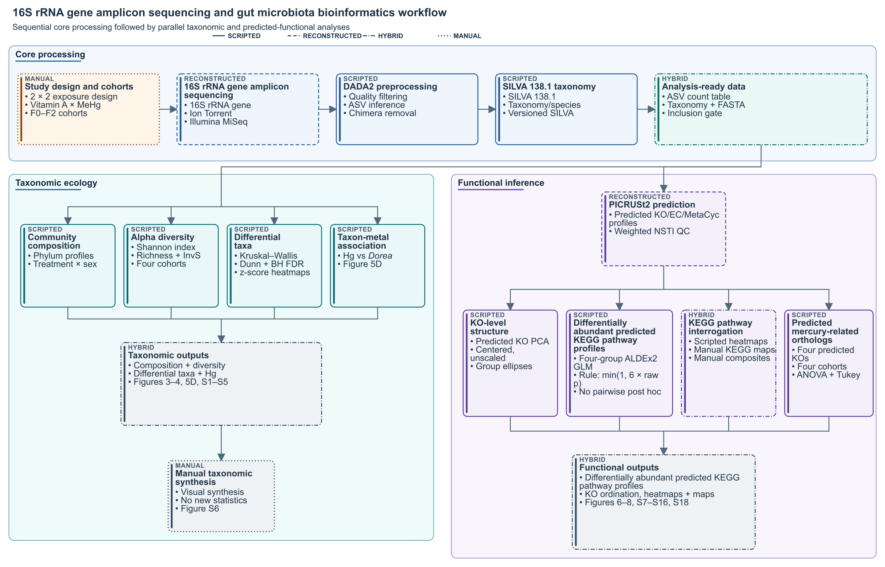

# MeHg–Vitamin A Gut Microbiota

This repository supports the reproducibility of a multigenerational gut microbiota study investigating methylmercury (MeHg) exposure, vitamin A supplementation, and their combined effects. It brings together curated metadata, processed 16S rRNA sequencing products, analysis results, and figure-generation workflows in a portable project structure. Analyses are implemented in R [@r-core], with method-specific software cited below and in the figure guides.

## Study overview

The experimental groups are:

- `CN`: control;
- `VitA`: vitamin A;
- `MeHg`: methylmercury;
- `VitA+MeHg`: combined vitamin A and methylmercury.

The microbiota data were generated in two sequencing batches:

| Batch | Biological material | Time point | Platform |
|---|---|---|---|
| `batch01_iontorrent_dams-f0_f1-pnd21` | F0 dams and F1 offspring | F1 at postnatal day 21 | Ion Torrent |
| `batch02_illumina-miseq_f1-f2_pnd365` | F1 and F2 offspring | Postnatal day 365 | Illumina MiSeq |

Sex, generation, treatment, sequencing batch, analysis inclusion, and data-deposition information are standardized in [`data/metadata/sample_manifest_all_batches.csv`](data/metadata/sample_manifest_all_batches.csv).

## Analysis workflow

[](figures/Figure_1/Workflow/output/Analysis_Workflow_generated.png)

The documentation displays only the repository-wide bioinformatics analyses workflow. The two-panel Figure 1 composite, which also includes the experimental design and sampling timeline, is a manuscript-preparation artifact. It can be regenerated with [`assemble_final_figure.js`](figures/Figure_1/assemble_final_figure.js), is retained under the Figure 1 workflow outputs, and is not embedded in this documentation.

**AI-generated figure disclosure:** The bioinformatics analyses workflow figure shown above was generated using generative AI and reviewed by the authors for scientific accuracy. It is a text-based flowchart without AI-generated illustrative or photographic content. [Springer Nature's current AI guidance](https://group.springernature.com/gp/group/ai/ai-guidance-for-our-researchers-and-communities) states that text-based flowcharts without images fall outside its generative-image restriction, but the authors should disclose the use and confirm the target journal's current instructions before submission.

The workflow begins with the manually defined 2 × 2 exposure design and F0–F2 cohorts. Two external 16S rRNA gene amplicon-sequencing batches are processed with DADA2, assigned SILVA 138.1 taxonomy, and combined with curated metadata to create analysis-ready ASV counts, taxonomy, and representative sequences.

From the analysis-ready data, the repository separates the analyses into two parallel branches:

- **Taxonomic ecology:** community composition, alpha diversity, differential-taxon testing, and the *Dorea*–mercury association produce Figures 3–4, 5D, and S1–S5. Figure S6 is a manual qualitative derivative of these taxonomic results.
- **Predicted functional profiles:** PICRUSt2 predicted KO/EC/MetaCyc profiles support parallel KO PCA, differential testing of predicted KEGG pathway profiles, KO heatmap and KEGG-map interpretation, and targeted predicted mercury-related ortholog analyses. These outputs map to Figures 6–8, S7–S16, and S18. Behavioral Figure S17 is outside this workflow.

Card labels and border patterns distinguish scripted, restructured, hybrid, and manual steps. The scientific DAG, wording, evidence status, execution status, visual mapping, and figure-output mappings are available in the machine-readable [`workflow_spec.json`](figures/Figure_1/Workflow/workflow_spec.json); an accessible text description is provided in [`Analysis_Workflow_alt_text.md`](figures/Figure_1/Workflow/output/Analysis_Workflow_alt_text.md). The rendering entry point and rasterizer are retained as implementation references, while the standalone validator and shared validation-helper source files are intentionally retained only in local working copies for now and excluded from version control. Consequently, end-to-end regeneration currently requires those local companion files.

## Repository status

This repository is under active reproducibility curation.

- The two batch-specific FASTQ workflows have been consolidated into a portable, linear [`DADA2 preprocessing script`](scripts/01_sequence_processing/preprocess_16s.R). Its configuration, versioned SILVA 138.1 Zenodo references, archived-data contracts, and batch-specific output serializers have been validated without raw reads. The raw reads are now publicly available; a full rerun and automatic comparison with the archived products remain pending download and verification of the accession-to-`sample_id` mapping.
- Figure 3 panels A-K, Figure 4 panels A-D, Figure 5 panel D, Figure 6 panels A-C, Figure S1 panels A-H, all 75 taxon-abundance panels in Figures S2-S5, panels E of Figures 7 and 8, and all ten KO z-score heatmaps in Figures S8-S16 have portable, tested workflows. The 19 KO-level source tables shared by Figures 7, 8, and S8-S16 also have a portable, regression-tested generator. Their KEGG pathway panels remain retained manual exports prepared with the generated z-score tables as the coloring reference; supplied final composites are retained for visual validation.
- Figure S3 generated panels and final composite use the same authoritative treatment order and colors as the other abundance panels: `CN` (`#98F5FF`), `VitA` (`#B3EE3A`), `MeHg` (`#CD2626`), and `VitA+MeHg` (`#4D4D4D`).
- Figure S6 is a manual, qualitative synthesis made by visually reviewing the current Figure 5 and Figures S2-S5 composites. Its interpretive construction and reproducibility boundary are documented in the [`supplementary-figure guide`](supplementary_figures/README.md#figure-s6); it is not presented as the output of a statistical or scripted workflow.
- The PICRUSt2 terminal workflow, exact batch-specific inputs, analysis-ready outputs, and weighted-NSTI quality metrics have been harmonized and validated against the supplied pipeline products. Figure 6 uses only the canonical KO predictions and canonical sample manifest.
- Historical scripts cited by the provenance documentation are isolated under [`scripts/legacy_scripts/`](scripts/legacy_scripts/). Privacy-sanitized copies preserve the analytical commands while replacing personal names, workstation paths, and user-specific output names. Unreferenced exploratory scripts and placeholder-only directories were removed during the repository-wide review.

## Repository structure

| Path | Contents |
|---|---|
| [`data/`](data/) | Data organization and provenance documentation. |
| [`data/metadata/`](data/metadata/) | Canonical sample manifests, preserved source metadata, SRA information, and validation summaries. |
| [`data/processed/`](data/processed/) | Processed ASV tables, taxonomy, representative sequences, BIOM files, relative abundances, and read tracking. |
| [`data/reference/`](data/reference/) | Small, versioned reference objects required by portable analysis workflows. |
| [`data/external/`](data/external/) | Download and checksum documentation plus the ignored local location for the SILVA 138.1 DADA2 reference FASTAs. |
| [`figures/`](figures/) | Main-figure workflows and lightweight generated outputs. |
| [`figures/Figure_1/`](figures/Figure_1/) | Figure 1 experimental-design source, AI-generated documentation workflow and specification, accessibility text, assembly script, and retained manuscript-preparation composite. |
| [`results/`](results/) | Alpha-diversity and taxon-abundance tables, functional-prediction exports, and legacy summary tables. |
| [`scripts/`](scripts/) | Maintained preprocessing and functional-analysis workflows plus documented historical provenance. |
| [`scripts/legacy_scripts/`](scripts/legacy_scripts/) | Privacy-sanitized legacy references already mapped to portable figure and PICRUSt2 workflows. |
| [`supplementary_figures/`](supplementary_figures/) | Supplementary-figure workflows, retained composites, and generated panel outputs. |
| [`bibliography.bib`](bibliography.bib) | Shared bibliography for software, databases, and analysis methods cited throughout the documentation. |

Canonical data and metadata are stored once under `data/`. Figure scripts should read these files directly rather than duplicate them within figure directories.

## Data organization and analysis rules

- Use `data/metadata/sample_manifest_all_batches.csv` as the canonical sample-level metadata table.
- Join sample-level data using `sample_id`.
- Honor the `include_primary_analysis` field when selecting samples.
- Samples `10F` and `22F` are preserved for provenance but excluded from the primary analysis because of low sequencing quality.
- The unexpected batch 02 count-table column `t3` must not be analyzed unless valid metadata are supplied.
- Do not duplicate canonical data or metadata inside figure directories.
- Generate new figure outputs as lightweight, readable PNG files; do not generate new TIFF files.

Further details are available in the [`data`](data/README.md), [`metadata`](data/metadata/README.md), [`processed data`](data/processed/README.md), [`figures`](figures/README.md), and [`results`](results/README.md) documentation.

## Raw sequence availability

Raw FASTQ files are not stored in this repository. They have been deposited in the NCBI Sequence Read Archive [@sra] under [BioProject PRJNA1489663](https://www.ncbi.nlm.nih.gov/bioproject/PRJNA1489663):

- Dams F0 and F1-PND21: `SAMN61406324`–`SAMN61406377`;
- F1-PND365 and F2-PND365: `SAMN61407672`–`SAMN61407719`.

The records are publicly available through the BioProject landing page. The repository does not infer individual sample-to-BioSample or SRA-run assignments where these were not supplied; verify those assignments against the public NCBI metadata before renaming downloaded FASTQ files.

The deposited material is the source sequencing data (raw reads), not the analysis source code. The versioned preprocessing source code is [`scripts/01_sequence_processing/preprocess_16s.R`](scripts/01_sequence_processing/preprocess_16s.R). A full raw-read rerun also requires the accession-to-`sample_id` mapping that was not included in the supplied deposition metadata.

## Figure-output policy

Generated figures are stored as compact PNG files suitable for inspection and reproducibility checks. The repository-wide analysis workflow is additionally committed as an accessible canonical SVG with a visually matching PNG. Manually supplied publication/reference artifacts may be retained in their original format, but figure-generation scripts must not create new TIFF files. See [`figures/README.md`](figures/README.md).

Main figures use `figures/Figure_<number>/output/`; supplementary figures with
portable panel workflows use `supplementary_figures/Figure_S<number>/output/`.
Supplied assembled composites use `Figure_<id>_FinalFigure.png`, while portable
panel outputs use `Figure<id><panel>_generated.png`. Descriptive incoming
filenames should be normalized to this convention once the figure number and
panel mapping are confirmed. Scientific cohort conflicts must be documented
and resolved rather than hidden by renaming an artifact.

## License

Source code and documentation are distributed under the [MIT License](LICENSE). Original data, metadata, and figures contained in this repository are licensed under the [Creative Commons Attribution 4.0 International License](LICENSE-DATA-FIGURES.md), except where a file or directory identifies different terms. Third-party content remains subject to its original license, and the CC BY 4.0 grant applies only to material the repository authors are entitled to license.

## Quick start

Start R from the repository root and try one of these three representative examples:

To restore the recorded R environment first, install `renv` if necessary and run `renv::restore()` from the repository root. The lockfile covers maintained R workflows; archival scripts under `scripts/legacy_scripts/` are intentionally excluded.

1. Generate Figure 3 panels A–C (taxonomic ecology):

   ```r
   source("figures/Figure_3/generate_figure_3_abc.R")
   generate_figure_3_abc()
   ```

2. Generate Figure 6 panel A (predicted functional profiles):

   ```r
   source("figures/Figure_6/generate_figure_6_a.R")
   generate_figure_6_a()
   ```

3. Generate the KEGG pathway KO z-score source tables:

   ```r
   source("scripts/04_functional_prediction/generate_kegg_pathway_ko_z_scores.R")
   generate_kegg_pathway_ko_z_scores()
   ```

Package requirements, preprocessing instructions, and the complete set of generation commands are documented in the [`16S preprocessing guide`](scripts/01_sequence_processing/README.md), [main-figure guide](figures/README.md), [supplementary-figure guide](supplementary_figures/README.md), and [PICRUSt2 workflow](scripts/04_functional_prediction/picrust2_workflow.md). Generated figures are written to their figure-specific `output/` directories, and generated functional source tables are written under `results/functional_prediction/`.

## AI use disclosure

Generative AI tools were used to assist with repository documentation, code review and refactoring, and reproducibility checks. All AI-assisted content and code were reviewed and validated by the authors, who retain full responsibility for the repository and its scientific conclusions. Generative AI was not used to generate the experimental data.

For a Springer Nature submission, substantive generative-AI use should be declared in the manuscript's Methods, Introduction, or Acknowledgements as required by the target journal. Its [current AI guidance](https://group.springernature.com/gp/group/ai/ai-guidance-for-our-researchers-and-communities) generally restricts AI-generated images but excludes text-based flowcharts without images; journal-specific instructions and any editor guidance should be checked at submission. Springer Nature's [research-data release guidance](https://support.springernature.com/en/support/solutions/articles/6000237623-release-of-research-data-ahead-of-manuscript-publication) says that public release of research data is generally not treated as prior publication, but the selected journal's Instructions for Authors remain controlling.

## References

- <a id="ref-aldex2"></a>Fernandes, A. D., Reid, J. N. S., Macklaim, J. M., McMurrough, T. A., Edgell, D. R., & Gloor, G. B. (2014). Unifying the analysis of high-throughput sequencing datasets: Characterizing RNA-seq, 16S rRNA gene sequencing and selective growth experiments by compositional data analysis. *Microbiome, 2*, 15. [https://doi.org/10.1186/2049-2618-2-15](https://doi.org/10.1186/2049-2618-2-15)
- <a id="ref-rlang"></a>Henry, L., & Wickham, H. (2026). *rlang: Functions for base types and core R and Tidyverse features* (Version 1.3.0) [R package]. [https://doi.org/10.32614/CRAN.package.rlang](https://doi.org/10.32614/CRAN.package.rlang)
- <a id="ref-kegg"></a>Kanehisa, M., & Goto, S. (2000). KEGG: Kyoto Encyclopedia of Genes and Genomes. *Nucleic Acids Research, 28*(1), 27–30. [https://doi.org/10.1093/nar/28.1.27](https://doi.org/10.1093/nar/28.1.27)
- <a id="ref-ggpubr"></a>Kassambara, A., & Erdey, L. (2026). *ggpubr: ggplot2 based publication ready plots* [R package]. [https://doi.org/10.32614/CRAN.package.ggpubr](https://doi.org/10.32614/CRAN.package.ggpubr)
- <a id="ref-rstatix"></a>Kassambara, A. (2026). *rstatix: Pipe-friendly framework for basic statistical tests* [R package]. [https://doi.org/10.32614/CRAN.package.rstatix](https://doi.org/10.32614/CRAN.package.rstatix)
- <a id="ref-sra"></a>Leinonen, R., Sugawara, H., Shumway, M., & International Nucleotide Sequence Database Collaboration. (2011). The Sequence Read Archive. *Nucleic Acids Research, 39*(Database issue), D19–D21. [https://doi.org/10.1093/nar/gkq1019](https://doi.org/10.1093/nar/gkq1019)
- <a id="ref-patchwork"></a>Pedersen, T. L. (2026). *patchwork: The composer of plots* [R package]. [https://doi.org/10.32614/CRAN.package.patchwork](https://doi.org/10.32614/CRAN.package.patchwork)
- <a id="ref-scales"></a>Posit Software, PBC. (2026). *scales: Scale functions for visualization* [R package]. [https://doi.org/10.32614/CRAN.package.scales](https://doi.org/10.32614/CRAN.package.scales)
- <a id="ref-r-core"></a>R Core Team. (2026). *R: A language and environment for statistical computing*. R Foundation for Statistical Computing. [https://doi.org/10.32614/R.manuals](https://doi.org/10.32614/R.manuals)
- <a id="ref-ggpicrust2"></a>Yang, C., Mai, J., Cao, X., Burberry, A., Cominelli, F., & Zhang, L. (2023). ggpicrust2: An R package for PICRUSt2 predicted functional profile analysis and visualization. *Bioinformatics, 39*(8), btad470. [https://doi.org/10.1093/bioinformatics/btad470](https://doi.org/10.1093/bioinformatics/btad470)
- <a id="ref-dplyr"></a>Wickham, H., François, R., Henry, L., Müller, K., & Vaughan, D. (2026). *dplyr: A grammar of data manipulation* (Version 1.2.1) [R package]. [https://doi.org/10.32614/CRAN.package.dplyr](https://doi.org/10.32614/CRAN.package.dplyr)
- <a id="ref-ggplot2"></a>Wickham, H. (2016). *ggplot2: Elegant graphics for data analysis* (2nd ed.). Springer. [https://doi.org/10.1007/978-3-319-24277-4](https://doi.org/10.1007/978-3-319-24277-4)
- <a id="ref-tidyverse"></a>Wickham, H., Averick, M., Bryan, J., et al. (2019). Welcome to the Tidyverse. *Journal of Open Source Software, 4*(43), 1686. [https://doi.org/10.21105/joss.01686](https://doi.org/10.21105/joss.01686)
